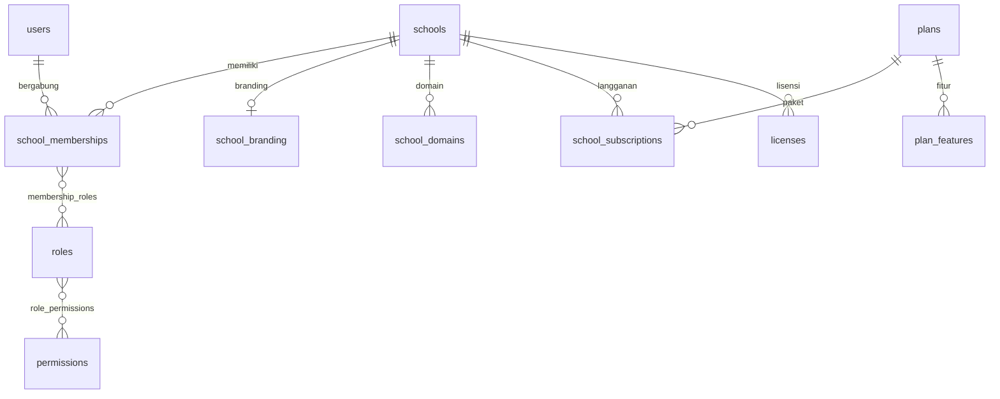
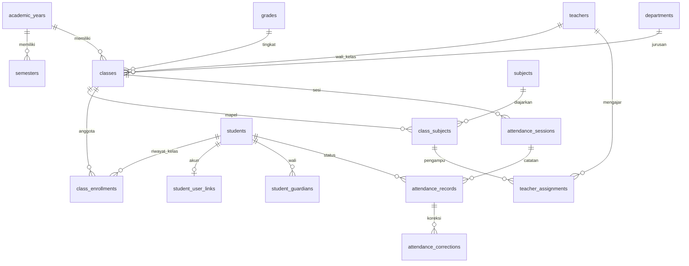
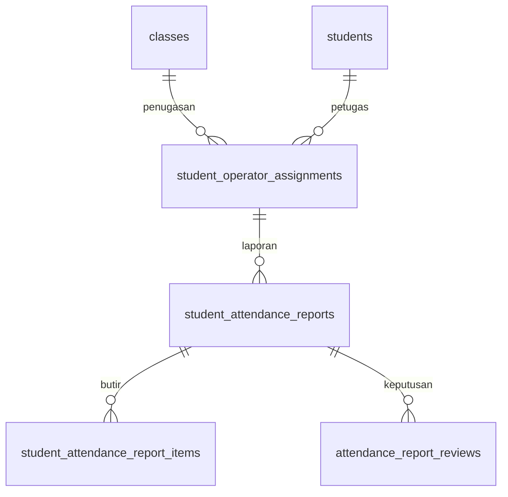

# ERD

Semua tabel milik sekolah membawa `school_id`. Relasi antar-tabel sekolah memakai foreign key gabungan `(school_id, id)`.

## Platform, akses, dan paket

## Akademik dan kehadiran

## Petugas kelas

## Komunikasi dan sistem

`announcements`, `announcement_targets`, `notifications`, `report_exports`, `audit_logs`, `backup_logs`, `import_jobs`, `system_settings`, `public_share_links`. Lihat [DATABASE.md](../../docs/DATABASE.md).
