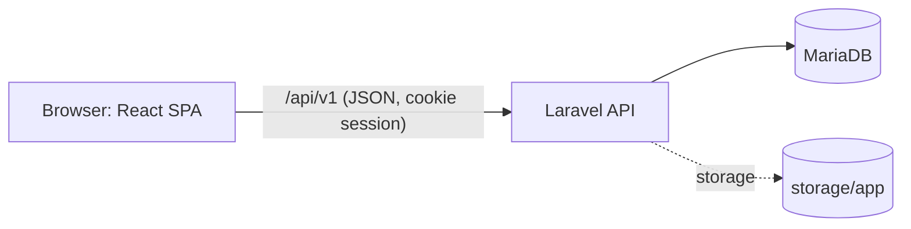
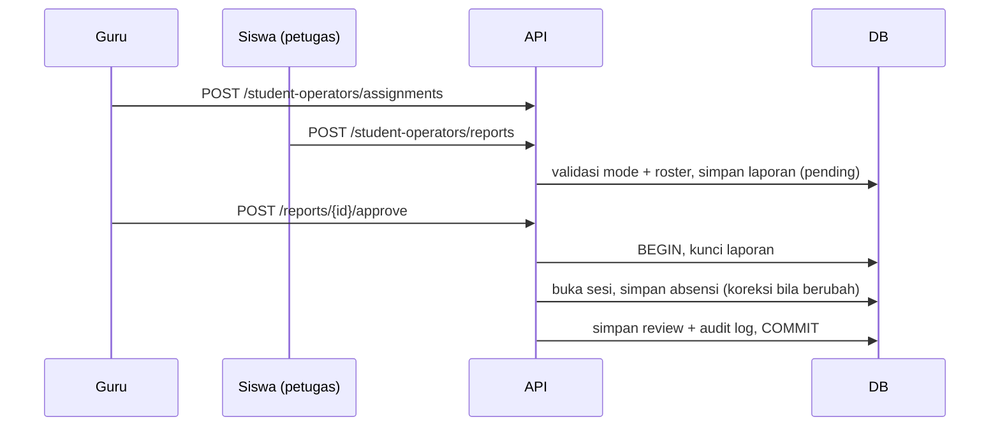

# Arsitektur

Frontend tidak pernah mengakses database. Semua komunikasi lewat API.

## Keputusan utama

| Topik | Keputusan | Alasan |
|---|---|---|
| Framework | Laravel 13, PHP 8.3–8.5 | Dukungan PHP 8.5 dari dokumentasi rilis; Laravel 12 sebagai cadangan |
| Autentikasi | Sanctum SPA (cookie session + CSRF) | Tidak menyimpan token di `localStorage` |
| Tenant | Kolom `school_id` + global scope fail-closed | Lihat bawah |
| RBAC | Permission → role sistem → membership; Policy per resource | Backend memutuskan; menu hanya kosmetik |
| Format error | `{ "error": { code, message, details } }` | Konsisten untuk frontend |
| Ekspor | ExcelJS dan jsPDF di browser | Sesuai spesifikasi awal; lihat risiko |

## Tenant isolation

Berlapis, agar satu lapisan yang bocor tidak langsung membuka data sekolah lain.

1. **Penentuan sekolah** (`ResolveTenant`): domain terverifikasi → header `X-School` (slug) → satu-satunya membership. Hasilnya wajib cocok dengan membership aktif pengguna, jika tidak 403. `school_id` dari body atau query tidak pernah dipercaya.
2. **Konteks per request** (`TenantContext`): menyimpan sekolah dan permission aktif.
3. **Scope model** (`BelongsToSchool` + `SchoolScope`): menambahkan `WHERE school_id = ?`. Tanpa konteks tenant, hasilnya `1 = 0` (fail-closed). Saat membuat data, `school_id` selalu ditimpa dari konteks.
4. **Validasi relasi** (`TenantRequest`): aturan `exists` dan `unique` dibatasi per sekolah, sehingga `grade_id` milik sekolah lain ditolak dengan 422.
5. **Database**: kunci unik `(school_id, id)` pada tabel induk dan **foreign key gabungan** `(school_id, x_id)` pada tabel anak. MariaDB menolak relasi lintas sekolah walau aplikasi keliru.
6. **Query mentah** (rekap) menyebut `school_id` eksplisit pada setiap tabel yang di-join.

Pengujian: `apps/api/tests/Security/TenantIsolationTest.php`.

## Alur Petugas Kelas

## Risiko dan keterbatasan

| Risiko | Catatan |
|---|---|
| Ekspor di browser | Untuk data besar atau laporan resmi, sisi server lebih aman. Tabel `report_exports` disiapkan untuk migrasi itu. |
| Domain white-label + cookie | Tiap domain sekolah harus masuk `SANCTUM_STATEFUL_DOMAINS` dan konfigurasi cookie. |
| Kolom virtual `active_student_id` | Menjamin satu enrollment aktif per siswa. Sudah berhasil dimigrasi di MariaDB 13.0.2; uji juga di versi MariaDB target. |
| Role dengan `school_id` null | Tidak bisa pakai foreign key gabungan; konsistensi dijaga di aplikasi. |
| Hosting tanpa SSH | Installer dan scheduler membutuhkan akses shell. |
