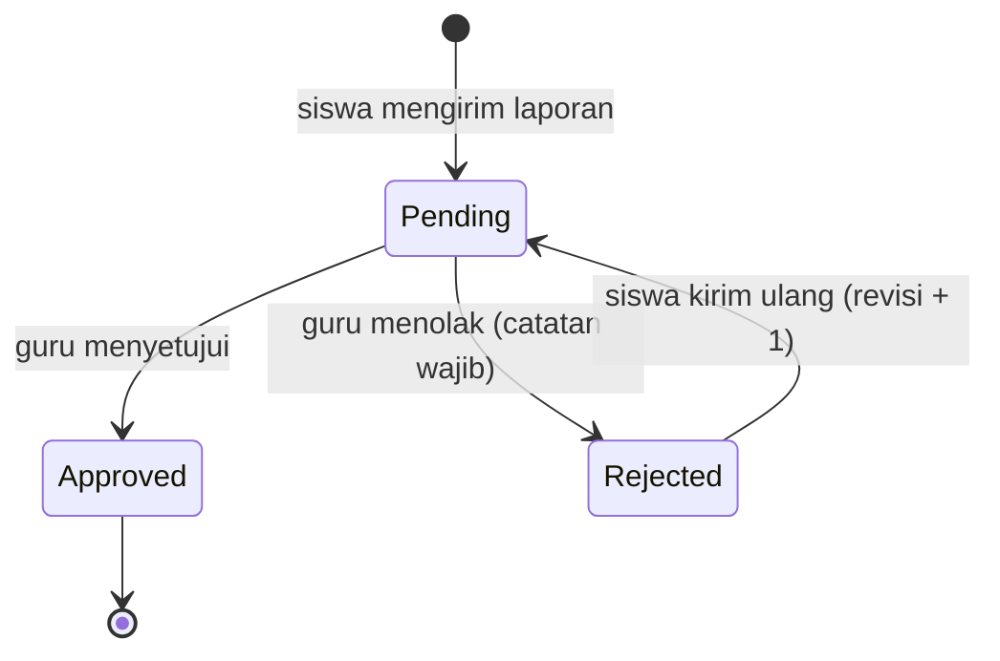

# Produk

**Classora** adalah *Smart School & Classroom Management Platform*. Tagline: **Kelola Sekolah, Lebih Mudah.**

## Prinsip

- **Satu instalasi, banyak sekolah.** Isolasi data per sekolah dijamin di backend dan di database.
- **Guru memegang keputusan.** Data kehadiran resmi hanya berubah lewat orang yang berwenang, dan setiap perubahan meninggalkan jejak.
- **Self-hosted.** Sekolah mengelola servernya sendiri; Docker tidak diwajibkan.
- **Tidak ada fitur palsu.** Fitur yang belum jadi ditandai belum jadi.

## Peran

| Peran | Tingkat | Ringkasan |
|---|---|---|
| Super Admin | Platform | Membuat sekolah baru. Tidak mengakses data sekolah. |
| Admin Sekolah | Sekolah | Semua izin sekolah |
| Kepala Sekolah | Sekolah | Melihat siswa, guru, kelas, absensi, rekap, audit; mengelola pengumuman |
| Guru | Sekolah | Mengisi dan mengoreksi absensi, menunjuk dan memeriksa petugas kelas, rekap |
| Wali Kelas | Sekolah | Guru + melihat guru + mengelola anggota kelas |
| Siswa | Sekolah | Dashboard |
| Petugas Kelas | Sekolah | Siswa dengan penugasan aktif; mengirim laporan kehadiran kelasnya |

Seorang pengguna dapat menjadi anggota lebih dari satu sekolah dengan peran berbeda.

## Modul

| Modul | Deskripsi |
|---|---|
| Siswa | NIS, NISN, nama, gender, status. Penghapusan = pengarsipan, riwayat tetap utuh. |
| Guru | Nomor pegawai, wali kelas, penugasan mengajar. |
| Kelas | Per tahun ajaran, tingkat, jurusan. Pindah kelas menutup enrollment lama tanpa menghapusnya. |
| Absensi | Hadir, Sakit, Izin, Alpa. Harian atau per sesi. Koreksi wajib beralasan. |
| Petugas Kelas | Lihat di bawah. |
| Rekap | Per siswa pada rentang tanggal; ekspor Excel dan PDF A4 landscape. |
| Branding | Nama aplikasi, warna utama, kop laporan. Fitur Pro. |

## Petugas Kelas

Guru atau wali kelas menunjuk seorang siswa dengan kelas, mode, tanggal mulai, dan tanggal berakhir.

| Mode | Yang dikirim siswa | Yang dilakukan guru |
|---|---|---|
| **Report Only** | Hanya siswa yang tidak hadir (sakit, izin, alpa) | Memeriksa dan menetapkan status resmi. Siswa yang tidak dilaporkan dianggap hadir, selama belum ada catatan resmi. |
| **Full Attendance** | Status seluruh siswa kelas | Memvalidasi seluruh pengajuan |

Aturan:
- Siswa tidak bisa menunjuk dirinya, menyetujui laporannya, atau mengubah absensi resmi.
- Siswa hanya mengakses kelas dan periode penugasannya. Menu **Petugas Kelas** muncul hanya bila ada penugasan aktif.
- Pemeriksa tidak boleh pembuat laporan.
- Persetujuan berjalan dalam satu transaksi dan tercatat di audit log.

## Freemium

| Community (gratis) | Pro |
|---|---|
| Siswa, guru, kelas, absensi, laporan dasar, ekspor dasar, branding Classora | White Label, analitik lanjut, laporan kustom, audit lanjut, backup otomatis, integrasi |

Tanpa payment gateway pada tahap ini. Fitur Pro dikendalikan lewat `plans`, `plan_features`, `school_subscriptions`, dan `licenses`. Hanya fitur `white_label` yang sudah dipakai di kode.
